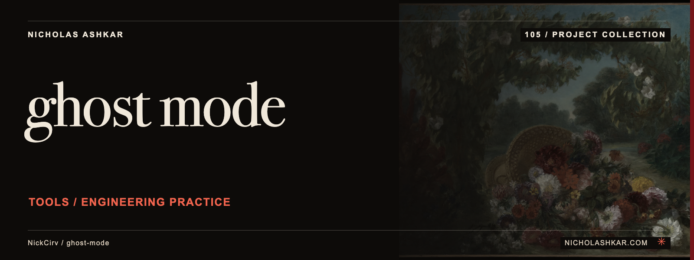

# ghost-mode

Non-blocking whisper hooks for Claude Code: secrets, leftover console.log, and TypeScript errors after every edit.


<a id="usage"></a>

## What it does

`ghost-mode install` writes three PostToolUse hooks into the project's `.claude/settings.json`. After Claude Code edits or writes a file, each hook receives the documented JSON payload on stdin (`hook_event_name`, `tool_name`, `tool_input.file_path`), inspects the touched file, and whispers a warning through the documented exit-0 JSON channel (`systemMessage` for you, `hookSpecificOutput.additionalContext` for Claude). No hook ever exits 2, so nothing is ever blocked. The contract is the one published in the [Claude Code hooks reference](https://code.claude.com/docs/en/hooks).

| Whisper | Fires on | What it checks |
| --- | --- | --- |
| [secret-whisper](src/scripts/secret-whisper.mjs) | `Edit\|Write\|MultiEdit` | Hardcoded credential patterns (password/API-key/token assignments, `sk-`, `AKIA`, `ghp_` shapes). Reports line number and pattern family only; never echoes the matched value. |
| [console-log-whisper](src/scripts/console-log-whisper.mjs) | `Edit\|Write\|MultiEdit` | `console.log(` in JS/TS files, with line numbers. Skips `*.test.*` and `*.spec.*`. |
| [type-error-whisper](src/scripts/type-error-whisper.mjs) | `Edit\|Write\|MultiEdit` | Runs the project's own `node_modules/.bin/tsc --noEmit` against the nearest `tsconfig.json` after a `.ts/.tsx/.mts/.cts` edit and whispers the first three errors. |

A note on history: releases before 2.0 passed `$CLAUDE_TOOL_INPUT_FILE_PATH` style environment variables that Claude Code never sets, so every hook was a silent no-op. Version 2.0 is a rewrite onto the real stdin-JSON contract, with an integration harness that pipes fixture payloads through each hook and asserts on exit codes and output. `install` on a project that still carries the old entries removes them.

<a id="install"></a>

## Quickstart

Node requirement from the manifest: **`>=20`**. Installation and config commands rewrite the project's `.claude/settings.json`; review the three scripts before enabling them. The following was executed on this revision (macOS, Node 26) with all 25 tests passing:

```bash
git clone https://github.com/NickCirv/ghost-mode.git
cd ghost-mode
npm install
npm test            # 25 pass, 0 fail: hook harness + installer round-trip + smoke

cd /path/to/your/project
node /path/to/ghost-mode/bin/ghost.js install --mode balanced
```

The hooks are registered by absolute path, so keep the clone where it was when you ran `install` (or re-run `install` after moving it). Claude Code snapshots hook configuration at session start; restart the session or review hook changes via `/hooks` after installing.

## What gets written

`install --mode balanced` produces entries of this shape in `.claude/settings.json` (captured from a real run, paths shortened):

```json
{
  "hooks": {
    "PostToolUse": [
      {
        "matcher": "Edit|Write|MultiEdit",
        "hooks": [
          {
            "type": "command",
            "command": "node \"/path/to/ghost-mode/src/scripts/secret-whisper.mjs\""
          }
        ]
      },
      {
        "matcher": "Edit|Write|MultiEdit",
        "hooks": [
          {
            "type": "command",
            "command": "node \"/path/to/ghost-mode/src/scripts/console-log-whisper.mjs\""
          }
        ]
      }
    ]
  }
}
```

And a firing hook answers on stdout with exit 0:

```json
{
  "systemMessage": "ghost-mode: console.log left in demo.js (line 2). Remember to remove before commit.",
  "hookSpecificOutput": {
    "hookEventName": "PostToolUse",
    "additionalContext": "ghost-mode console.log whisper: /tmp/demo/demo.js contains console.log at line 2. ..."
  }
}
```

## Usage and reference

`ghost-mode` is the executable name declared by the package. [Command reference](docs/REFERENCE.md) covers options and entry points.

| Control | Behavior |
| --- | --- |
| `status` | Report whether ghost hooks (any version) are present in `./.claude/settings.json` |
| `install --mode MODE` | Write hooks for aggressive, balanced or subtle mode; replaces prior ghost entries, keeps yours |
| `config MODE` | Update mode and reinstall hooks |
| `uninstall` | Remove ghost entries only; unrelated hooks are preserved |

Modes select which whispers run: subtle is secrets only, balanced (default) adds console.log, aggressive adds the tsc run (a full project typecheck on every TS edit, so it costs seconds per edit on large projects).

## What these hooks can and cannot see

Honest scope, so you can decide whether the whispers are worth the noise:

- They see only the file Claude Code just edited or wrote (`tool_input.file_path`). Files you change in your own editor, in a terminal, or through git never pass through these hooks.
- They are regex and compiler checks, not an AI reviewer. The secret patterns catch common shapes (quoted assignments, AWS/GitHub/OpenAI-style tokens) and skip lines that read from the environment; an encoded or unusual secret will pass. Use gitleaks or similar in CI as the real gate.
- The console.log check matches the literal call text line by line; a commented-out `console.log` still whispers, a cleverly aliased logger does not.
- The TypeScript whisper needs a reachable `tsconfig.json` and a locally installed `tsc` (it never downloads one). It typechecks the whole project, so some reported errors may predate the edit. No tsconfig or no tsc means it stays quiet by design.
- Warnings only: every hook exits 0 in every case, including internal errors. A whisper can be ignored and never interrupts the session.

## Development

```bash
npm test
```

`test/hooks.test.js` is the integration harness: it spawns each hook as a child process, pipes fixture PostToolUse payloads to stdin, and asserts on exit code and the JSON whisper (including that secret values are not echoed back and malformed stdin exits 0). `test/installer.test.js` round-trips install/uninstall against temp projects, including upgrade from the legacy v1 entries. `test/smoke.test.js` keeps the entrypoint syntax-checked.

| Script | Declared command |
| --- | --- |
| `start` | `node bin/ghost.js` |
| `test` | `node --test` |

## Research and status

[Research record](docs/RESEARCH.md) documents the earlier source inspection and the 2.0 rewrite that replaced the non-functional v1 hook contract. The hook payload and output fields used here follow the official hooks reference linked above; if Claude Code changes that contract, the harness fixtures are the place to update first.

## License and author

[License](LICENSE)

[Nicholas Ashkar](https://nicholashkar.com) · Applied AI, systems and consulting.
